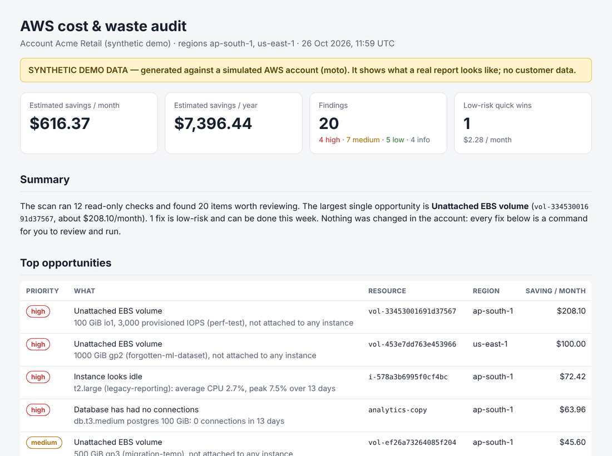

# AWS Bill Doctor

[](https://github.com/ObaidAbdullah16/aws-bill-doctor/actions/workflows/ci.yml)

> **Demo data notice:** the reports in [`sample-report/`](sample-report), [`sample-security-report/`](sample-security-report)
> and [`sample-health-check/`](sample-health-check) come from **synthetic** AWS accounts simulated with
> [moto](https://github.com/getmoto/moto) (the security one runs real Prowler checks against the simulator).
> They show what a client receives; none is a real customer's account.

Two read-only services in one tool: **cost** (S1, below) and the **security baseline check** (S8,
[further down](#security-baseline-check-s8)). Sold together they are the **AWS Health Check**: one role, one report.

Read-only AWS waste finder behind my **AWS Bill Doctor** service (S1). Flexera's 2026 State of the Cloud
puts wasted cloud spend at about 29% - small teams feel it most because nobody owns FinOps. Bill Doctor runs
12 checks across every region, estimates the monthly saving of each finding, and produces a client-ready
HTML/PDF report with the exact command to fix each item. **It never changes anything.**



## The 12 checks

| ID | Finds | Typical fix |
|---|---|---|
| EBS-001 | Unattached EBS volumes | snapshot + delete |
| EBS-002 | gp2 volumes (gp3 is ~20% cheaper) | `modify-volume --volume-type gp3` (online) |
| EBS-003 | Snapshots older than 90 days not used by an AMI | delete / Data Lifecycle Manager |
| EC2-001 | Elastic IPs attached to nothing ($3.65/month each since 2024) | release |
| EC2-002 | Instances stopped > 30 days still paying for EBS | AMI + terminate |
| EC2-003 | Running instances with avg CPU < 5% and peak < 20% for 14 days | stop / schedule / downsize |
| EC2-004 | Previous-generation types (t2, m4, c4, r4...) | change type |
| ELB-001 | Load balancers (ALB/NLB/Classic) with no targets | delete |
| NAT-001 | NAT gateways moving < 1 GB in 14 days | delete / VPC endpoints |
| RDS-001 | Databases with zero connections for 14 days | final snapshot + delete |
| LOGS-001 | Log groups with "never expire" retention | set retention |
| S3-001 | Buckets without lifecycle rules for multipart uploads / old versions | lifecycle rule |

Savings are counted **once per resource** (an idle `t2.large` is not counted as both "stop it" and
"upgrade it"), and overlapping checks skip each other's resources.

## Try it without an AWS account

```bash
pip install -e ".[demo]"
billdoctor demo --out sample-report      # synthetic account -> report.html, report.md, findings.json/csv
```

## Scan a real account

```bash
bash scripts/scan-my-account.sh     # your own account: cost + security in one report (audits/my-account/<date>/)
python3 -m venv .venv && source .venv/bin/activate && pip install -e .      # or install the CLI yourself
billdoctor scan --profile my-account --regions ap-south-1,us-east-1 --out report/
billdoctor scan --role-arn arn:aws:iam::<client>:role/BillDoctorReadOnly --external-id <id> --regions all
billdoctor policy        # the exact read-only IAM policy (no data access, no write actions)
```

Client onboarding uses [`client-access/cloudformation-readonly-role.yaml`](client-access/cloudformation-readonly-role.yaml):
a cross-account role with an **external ID** and only `Describe/List/Get` permissions - no S3 object reads,
no database access. A Terraform version is in `client-access/terraform/`.

After the audit, [`terraform/budget-guard`](terraform/budget-guard) installs budgets with 80%/100% and
forecast alerts so the savings stick.

## Live in this repo

- **CI** runs 46 tests against moto, lints the code, validates the Terraform and CloudFormation, and
  regenerates the synthetic cost, security and health-check sample reports as build artifacts.
- **Scan my AWS account** (Actions tab) scans your own account monthly - cost and security baseline - using the
  read-only OIDC role from `aws-foundation`; no keys stored in GitHub. The reports are downloadable artifacts.

## Accuracy notes

- Prices in [`billdoctor/pricing.py`](billdoctor/pricing.py) are approximate on-demand list prices (Oct 2026)
  for us-east-1 and ap-south-1. Missing regional prices fall back to us-east-1 and the report says so.
- Discounts, Savings Plans and Reserved Instances are not applied - savings are upper-bound estimates.
- EBS costs include provisioned performance (io1/io2 IOPS, gp3 IOPS and throughput above the free baseline).
- NAT-001 counts traffic in both directions, so a gateway used mostly for downloads is not called idle.
- Idle detection uses 14 days of CloudWatch daily statistics; instances with fewer than 3 days of data are skipped.

## Security baseline check (S8)

A fixed-price, read-only review of the 25 AWS settings behind most cloud breaches, with every fix as code
and a retest. Wiz attributes about 80% of 2025's cloud breaches to basic mistakes like these. The scanner is
[Prowler](https://github.com/prowler-cloud/prowler) (Apache-2.0), **not rewritten here**: this repo adds the
curated control set, two native checks Prowler lacks, a severity-weighted score, the client report in the
same format as the cost report, a DPDP view for Indian startups, the access role, and the retest.

```bash
billdoctor security demo --out sample-security-report     # simulated account: 31/100 (F) -> 97/100 (A) after the fix pack
billdoctor security controls                               # the 25 controls and the checks behind them
pipx install prowler                                       # Prowler is installed on its own
billdoctor security scan --profile my-account --regions ap-south-1,us-east-1 --out security-report/
billdoctor security scan --role-arn arn:aws:iam::<client>:role/BillDoctorReadOnly --external-id <id> --regions all --dpdp
billdoctor security report --prowler-json existing.ocsf.json --out report/   # convert a Prowler run you already have
billdoctor security scan ... --previous old/findings.json                    # retest: fixed / still open / new
billdoctor health-check --role-arn ... --external-id <id> --out audits/acme  # cost + security, one summary page
```

| ID | Severity | Control | Checks |
|---|---|---|---|
| ID-01 | critical | Root user is protected (MFA on, no access keys) | `iam_root_mfa_enabled`, `iam_no_root_access_key` |
| ID-02 | high | Every console user has MFA | `iam_user_mfa_enabled_console_access` |
| ID-03 | high | Access keys are rotated and unused keys removed | `iam_rotate_access_key_90_days`, `iam_user_accesskey_unused`, `iam_user_console_access_unused` |
| ID-04 | medium | People get permissions through groups, roles or SSO - not attached to users | `iam_policy_attached_only_to_group_or_roles` |
| ID-05 | high | Full administrator rights are limited to a break-glass role | `iam_aws_attached_policy_no_administrative_privileges`, `iam_customer_attached_policy_no_administrative_privileges`, `iam_inline_policy_no_administrative_privileges` |
| ID-06 | low | Password policy requires long, non-reused passwords | `iam_password_policy_minimum_length_14`, `iam_password_policy_reuse_24` |
| ID-07 | medium | IAM Access Analyzer watches for external access | `accessanalyzer_enabled` |
| LD-01 | critical | CloudTrail records every region, with tamper-evident, private logs | `cloudtrail_multi_region_enabled`, `cloudtrail_log_file_validation_enabled`, `cloudtrail_logs_s3_bucket_is_not_publicly_accessible` |
| LD-02 | high | GuardDuty threat detection is on | `guardduty_is_enabled` |
| LD-03 | medium | AWS Config records configuration changes | `config_recorder_all_regions_enabled` |
| LD-04 | medium | Log groups keep logs for at least a year | `cloudwatch_log_group_retention_policy_specific_days_enabled` |
| LD-05 | medium | Spend alerts would catch abuse within a day | native: `spend_alerts` |
| DA-01 | critical | S3 Block Public Access is on for the whole account | `s3_account_level_public_access_blocks` |
| DA-02 | critical | No bucket is public | `s3_bucket_public_access`, `s3_bucket_policy_public_write_access`, `s3_bucket_public_list_acl`, `s3_bucket_public_write_acl` |
| DA-03 | medium | Data is encrypted by default (S3 and EBS) | `s3_bucket_default_encryption`, `ec2_ebs_default_encryption` |
| DA-04 | high | Databases are encrypted, private, backed up and protected from deletion | `rds_instance_storage_encrypted`, `rds_instance_no_public_access`, `rds_instance_backup_enabled`, `rds_instance_deletion_protection` |
| DA-05 | critical | No snapshot is public | `ec2_ebs_public_snapshot`, `rds_snapshots_public_access` |
| NC-01 | critical | No SSH, RDP or database port is open to the whole internet | `ec2_securitygroup_allow_ingress_from_internet_to_tcp_port_22`, `ec2_securitygroup_allow_ingress_from_internet_to_tcp_port_3389`, `ec2_securitygroup_allow_ingress_from_internet_to_tcp_port_mysql_3306`, `ec2_securitygroup_allow_ingress_from_internet_to_tcp_port_postgres_5432`, `ec2_securitygroup_allow_ingress_from_internet_to_all_ports` |
| NC-02 | low | Default security groups allow no traffic | `ec2_securitygroup_default_restrict_traffic` |
| NC-03 | high | Instances require IMDSv2 | `ec2_instance_imdsv2_enabled`, `ec2_instance_account_imdsv2_enabled` |
| NC-04 | medium | Only intended instances have public IP addresses | `ec2_instance_public_ip` |
| SP-01 | critical | No secrets in Lambda variables, EC2 user data or launch templates | `awslambda_function_no_secrets_in_variables`, `ec2_instance_secrets_user_data`, `ec2_launch_template_no_secrets` |
| SP-02 | medium | Secrets Manager secrets rotate automatically | `secretsmanager_automatic_rotation_enabled` |
| SP-03 | high | CI/CD logs in with short-lived OIDC credentials, not stored keys | native: `ci_oidc` |
| SP-04 | low | Container images are scanned on push and tags are immutable | `ecr_registry_scan_images_on_push_enabled`, `ecr_repositories_scan_images_on_push_enabled`, `ecr_repositories_tag_immutability` |

**Score:** each evaluated control counts by severity (critical 10, high 6, medium 3, low 1); grades as in
ghaudit (A ≥ 90 ... F < 40). Controls with no matching resources, or that could not be evaluated, are left
out of the score and reported as **coverage**, so a high score on little data is visible.

**Access:** `client-access/` templates with `EnableSecurityCheck=true` (CloudFormation) or
`enable_security_check = true` (Terraform) attach the AWS-managed `SecurityAudit` and `ViewOnlyAccess`
policies plus [a few extra reads](policies/security-check-readonly.json). The same role **always** carries an
explicit deny on reading data (S3 objects, database rows, secret values, log events) - for cost audits too.

**Proof:** besides the simulator samples, [`demo-account/`](demo-account) builds a *real*, deliberately
misconfigured sandbox account with Terraform, scans it and destroys it in one command (about $0.05), giving
`sample-security-report-real/` (`run-demo.sh`; or `up.sh` / `scan.sh` / `down.sh` step by step).

**India:** `--dpdp` switches to the DPDP technical-safeguards view ([docs/dpdp](docs/dpdp)) with a 72-hour breach
runbook. It is technical readiness, not legal advice.

**Delivering it:** [docs/security-playbook.md](docs/security-playbook.md); paperwork templates in
[docs/templates](docs/templates) (authorisation letter, statement of work, data-deletion confirmation).
Fixes come from the `security-baseline` Terraform module in the `aws-foundation` repository.

### Design notes (for interviews)

- **Wrap, don't rewrite.** Prowler maintains hundreds of checks and their framework mappings; the value I add is
  selection, review, ranking and fixes. CIS references in the report come from Prowler's own mapping, never typed by hand.
- **No result is not a pass.** Account-level controls with no result are "not evaluated"; resource-level ones are
  "no resources". Both are excluded from the score and shown as coverage.
- **The demo runs real checks.** `scripts/make_security_demo_fixture.py` seeds a fictional company into a moto
  server and runs Prowler against it; the trimmed results ship with the package so CI needs neither AWS nor Prowler.
- **Least privilege, provably.** Prowler's documented extra policy includes image and log reads the 25 controls do
  not need, so the role uses a smaller allow list and denies data reads outright.
- **Data minimisation.** Prowler's raw output is deleted after conversion unless `--keep-raw`; reports hold
  finding messages, never secret values.

## How I deliver it as a service

Cost (S1): [docs/service-playbook.md](docs/service-playbook.md): free call -> read-only role -> scan -> human review
-> PDF + walkthrough -> budget guard -> 30-day follow-up. Security (S8): [docs/security-playbook.md](docs/security-playbook.md).

MIT licensed.
